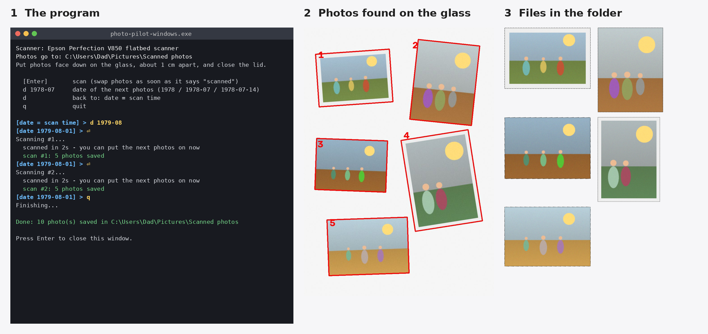

# photo-pilot

Scan a whole glass full of old prints at once with an **Epson Perfection** flatbed.
photo-pilot finds each photo, cuts it out, straightens it, and saves it as its **own
full-resolution JPEG** in a folder. Point Immich (or anything else) at that folder and you're done.

Runs on **Windows** and **Linux Mint** (and other Linux distributions or macOS).



## Supported scanners

Any Epson Perfection flatbed that has an Epson driver for your system, for example
V850 Pro, V800, V750 Pro, V700, V600, V550, V500, V370, 4990, 4490, 4870, 3200 and 2400. Other
brands also work if Windows (WIA) or Linux (SANE) can see them. Prints only: it scans the glass
(flatbed), not the film/slide holder.

## Download: two programs

| System | File |
|---|---|
| Windows 10 / 11 | `photo-pilot-windows.exe` |
| Linux Mint 21+ (or Ubuntu 22.04+) | `photo-pilot-linux` + `linux/install-linux-mint.sh` |

Get them from this repository's **Releases** page, or from the **Actions** tab: open the
latest "Build programs" run and download them under *Artifacts*. They are built automatically
on every push, and a tag like `v0.1.0` publishes them as a release. Neither needs Python.

### Windows

1. Install the scanner driver for your model from Epson's support site. Look for
   **Epson Scan** or **Epson Scan 2**: it also installs the Windows (WIA) driver photo-pilot uses.
2. Double-click **`photo-pilot-windows.exe`**. Windows SmartScreen may warn about an unknown
   program: choose *More info → Run anyway*.
3. Close Epson Scan while photo-pilot runs: only one program can use the scanner at a time.

### Linux Mint

1. Put `photo-pilot-linux` and `install-linux-mint.sh` in the same folder. Run
   `sh install-linux-mint.sh`, which installs SANE and adds a **"Scan photos"** menu entry
   and desktop icon. Log out and back in once.
2. If `scanimage -L` doesn't list the scanner, install Epson's Linux driver. On Epson's
   support site, choose your model and **Linux** as the operating system:
   * **V850, V800, V600, V550, V370 and newer**: *Epson Scan 2* (`epsonscan2` `.deb` bundle,
     plus the non-free plugin if your model needs it). Run its `install.sh`.
   * **Older models (V700, V750, 4990, 4490, …)**: often work out of the box through SANE's
     `epson2` backend. Otherwise install *Image Scan! for Linux* (`iscan`) and its plugin for your model.
3. Start **Scan photos** from the menu.

## Using it

Double-click the program. No questions are asked: it goes straight to scanning.

1. Put photos face down on the glass, about **1 cm apart**, and close the lid.
2. Press **Enter**.
3. As soon as it says *"scanned"*, swap in the next photos. Cutting out and saving happens
   in the background while you do that.
4. Type **`q`** when you're done.

Optional: type `d 1979-08` before scanning a batch to stamp those photos with the date they were
taken. The date goes into the photo's EXIF data, so Immich shows them in the right year.
Without it, the scan time is used.

**Where the photos go:** `Pictures\Scanned photos` (Windows) or `~/Pictures/Scanned photos`
(Linux). To use another folder, for example one that Immich imports from, run
`photo-pilot-windows.exe setup` once (Linux: `photo-pilot setup`) and type the folder.

**What lands in the folder:** only the photos, named like `20261006-153012-01.jpg`. They are
at full scan resolution, JPEG quality 95, without colour subsampling. Each file appears only
once it's completely written, so a folder watcher never picks up half a photo. Nothing is ever
overwritten. Duplicates are not checked: Immich can find those later.

**Getting it into Immich:** add the folder as an **External Library** in Immich
(Administration → External Libraries), or upload it with the Immich app or CLI. Any folder
sync to the Immich machine works too.

### Resolution

The default is **600 dpi**. A 10×15 cm (4×6") print becomes about 2400×3600 px (8.6 MP), which
is all the detail a typical print holds. For small prints you may want to enlarge, use
**1200 dpi**: run `photo-pilot-windows.exe scan --dpi 1200`. Scanning takes about 4× longer and
the files are about 4× bigger.

Measured: cutting up and saving a full glass takes under 1.5 s even at 1200 dpi, so the
scanner itself is the only wait.

### Tips

* Photos that **touch** are cut out as one. Leave a gap.
* Photos with **white borders on the white lid** are the hardest case. A sheet of **black paper**
  laid over the photos (under the lid) makes detection near perfect. Also try `--sensitivity 1.5`.
* A small preview of each scan, with the detected photos outlined in red, is kept outside the
  photo folder: `%APPDATA%\photo-pilot\previews` (Windows), `~/.config/photo-pilot/previews`
  (Linux). The latest 30 are kept.
* Place photos upright where you can. Turning one sideways in Immich takes one click.

### If direct scanning doesn't work

If the program can't reach the scanner, it offers a fallback. Scan with Epson's own software
(whole glass, auto-crop **off**, TIFF or JPEG) into `Pictures/Epson Scan`, and photo-pilot cuts
up each new file as soon as it appears.

### Command line

```sh
photo-pilot scan [--dpi 1200] [--out FOLDER] [--date 1979-08] [--keep-raw]
photo-pilot import scans/          # cut up existing full-glass scans (files or a folder)
photo-pilot watch "Epson Scan"     # cut up each new scan that appears in a folder
photo-pilot setup                  # choose the photo folder
photo-pilot devices                # which scanners are visible
```

`photo-pilot <command> --help` shows every option.

## How it works

* **Finding photos** (`photopilot/detect.py`): the colour of the lid is measured at the edges of
  the scan. Anything that differs from it, or shows a sharp edge, is treated as photo. This runs
  on a small copy of the scan, so it's fast. Each blob becomes one photo, and its tilted rectangle
  is straightened and cut from the **full-resolution** scan, trimmed slightly so no lid shows at
  the edges.
* **Scanner access** (`photopilot/scanner.py`): WIA on Windows (`pywin32`). On Linux and macOS
  it uses SANE `scanimage`, and the scan goes straight into memory, with no temporary file.

## Development

```sh
pip install -e '.[test]'
pytest
pyinstaller --onefile --console --name photo-pilot --paths . packaging/launcher.py   # build a program
```

The tests build synthetic scans: white and black lid, photos with and without white borders,
tilted, with dust. They check full-resolution output, dates, file safety and accented folder
names. They also cover background saving in the scan loop and the watch folder, plus the Windows
WIA path against a fake driver and the Linux path against a fake `scanimage`. CI runs them on
Linux and Windows and builds both programs.
